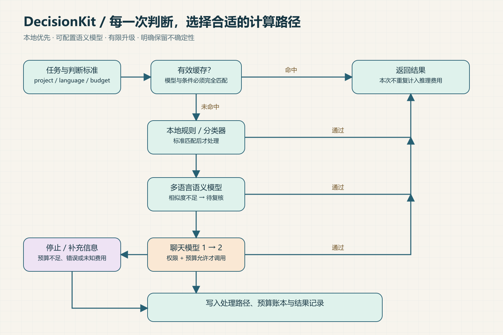
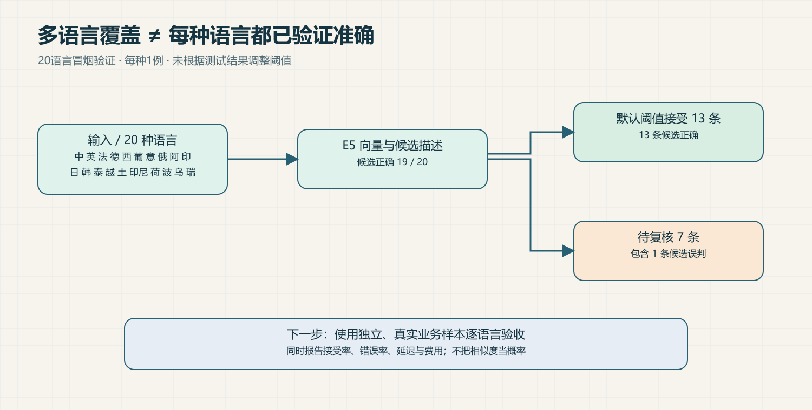
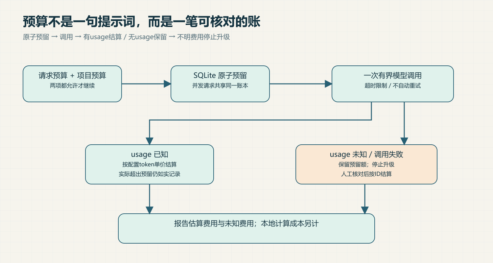

# DecisionKit

**Spend computation where it matters.**


小机器人负责分配任务：简单工作送往小机器，困难工作进入观测站，重复任务取自档案转盘，不确定任务先在长椅等候。主视觉为概念插画，流程与测试证据见下文。

面向 AI 助手的本地优先决策插件：用明确规则、可训练分类器、多语言语义模型和按需升级，完成可检查的结构化判断。提供 CLI、Python、MCP 与本机 HTTP 接口。



## 已实现的能力

| 能力 | 行为 |
|---|---|
| 本地分类 | Unicode字符/词特征训练，无第三方依赖 |
| 多语言语义 | 可选 E5 本地权重，超长输入拒绝静默截断 |
| 结构化判断 | classify、check、score、extract；非分类任务使用配置的聊天后端 |
| 有限模型升级 | 最多两个兼容聊天API，本地失败后按策略调用 |
| 成本控制 | 请求预算、项目累计预算、SQLite原子预留、未知费用保留 |
| 缓存 | 精确匹配、TTL、项目/标准/模型/权限隔离 |
| 可追踪性 | 处理路径、预算账本、耗时、未解决状态 |
| 可安装交付 | 清单校验、升级备份、编辑保护与失败回滚 |

## 立即试用

Python 3.10+，解压后进入目录：

```sh
python cli.py --config examples/config.json decide examples/request.json
python cli.py --config examples/config.json report demo
```

示例已包含演示训练模型，无需联网。示例仅覆盖特定中文反馈分类，不能作为通用语义模型。安装技能：

```sh
python install.py --check
python install.py
```

默认安装到 `~/.codex/skills/decision-kit`。支持自定义目标目录及 `--upgrade`；不会静默更改宿主配置。宿主是否自动调用取决于其能力与设置。

## 多语言从哪里来

使用 [multilingual-e5-small](https://huggingface.co/intfloat/multilingual-e5-small) 的跨语言向量表示。上游模型卡声明约100种语言覆盖，并指出低资源语言可能退化；这不是本插件100语言准确率保证。

```sh
python -m pip install -r requirements-semantic.txt
python fetch_model.py /absolute/models/multilingual-e5-small
```

权重单独下载，不塞进技能ZIP。后续加载离线运行。配置方法见 [使用说明](使用说明.md)。Qwen与llama.cpp可通过兼容聊天API接入；本包没有重新训练或分发Qwen权重。



## 测试证据

本机已实际加载 E5，对20种语言各1条合成样例进行冒烟测试：候选答案19/20正确；默认阈值接受13条，13条正确；7条待复核，其中包含1条误判。没有据此调整阈值。

这不是独立业务基准，也不能代表各语言生产准确率。软件测试与模型测试分开记录：[验收报告](验收报告.md)、[原始语义结果](evals/semantic-results.json)、[测试结果](test-results.json)。

## 成本必须算完整



token费用来自配置单价与服务端usage，属于估算。费用未知时保留预留额并停止升级。预留上界由操作员配置，不能替代供应商硬限额；本地设备成本未测。没有基线就不宣传节省比例。

可用 `evals/compare.py` 在同一批标注任务上比较两份配置，同时查看完成率、正确率和费用。该工具可能实际调用付费API。

## 适用边界

- 决策结果不直接触发退款、删除或发送消息等外部动作。
- E5相似度、朴素贝叶斯分数都未校准；字段合法不代表语义正确。
- HTTP为本机单用户工具，项目名不是多租户认证。
- 缓存可能保存抽取出的敏感内容，数据库未加密。
- 兼容API已用本地协议测试服务验证，未进行付费供应商或Jev对照实验。
- 提供可运行插件，不宣称复刻Jev底层架构、训练出新的基础模型或普遍优于Jev。

[完整使用说明](使用说明.md) · [开源选型与许可证](OPEN_SOURCE.md) · [MIT License](LICENSE)

首次配置可运行 `python setup_wizard.py /path/to/new-profile`，生成可直接运行的离线示例。费用对照支持按语言查看完成率、准确率和每个正确结果的估算费用。详见 [使用说明](使用说明.md)。
